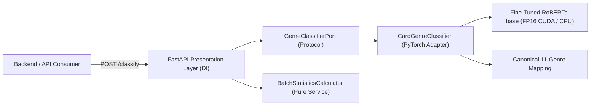

# 🧠 Yu-Gi-Oh! Card Mechanics Classifier — Multi-Label RoBERTa & FastAPI (`card-analysis`)

[](https://github.com/marcgaya98/card-analysis/actions/workflows/ci.yml)
[](./docker-compose.yml)
[](./requirements.txt)
[](./training/train.py)
[](./app/main.py)
[](./tests/test_api.py)
[](https://opensource.org/licenses/MIT)

> **Elevator Pitch:** Production-ready **multi-label NLP microservice** powered by a fine-tuned **`roberta-base`** transformer and **PyTorch (`CUDA` FP16 / CPU fallback)** that classifies raw Yu-Gi-Oh! card effect text into **11 canonical gameplay mechanics** in under `20 ms` per batch.

### 🌐 Ecosystem Repositories

| Repository | Role | Stack |
|---|---|---|
| **[`card-analysis`](https://github.com/marcgaya98/card-analysis)** *(this repo)* | Multi-Label Deep Learning Card Mechanics Classifier (`11 genres`) | Python 3.11, PyTorch, RoBERTa, FastAPI |
| **[`yugioh-ts-ddd`](https://github.com/marcgaya98/yugioh-ts-ddd)** | Core DDD REST API & Multimodal CLIP (`512-D`) Vector Search Engine | TypeScript, Express 5, Sequelize, MySQL 8, ONNX CLIP |
| **[`yugi-mcp`](https://github.com/marcgaya98/yugi-mcp)** | Model Context Protocol (MCP) Server exposing 22 tools to LLM Agents | TypeScript, MCP SDK (`stdio`), Zod |

---

## 1. Live Demo



---

## 2. System Architecture



### Supported Card Mechanics (`11 Canonical Genres`)

| Genre | Gameplay Mechanic Detected |
|---|---|
| `Remove card from play` | Banishing cards from the field, hand, Deck, or Graveyard |
| `Destroy Spell/Trap` | Destruction of Spell and Trap cards |
| `Destroy monster` | Destruction of monster cards by card effect |
| `Attribute` | Effects targeting or modifying specific Monster Attributes (`LIGHT`, `DARK`, `FIRE`, etc.) |
| `Type` | Effects targeting or supporting specific Monster Types (`Warrior`, `Spellcaster`, `Pyro`, etc.) |
| `Search Deck` | Adding or excavating cards from the Main Deck |
| `Recover cards from Graveyard` | Returning or retrieving cards from the Graveyard (`GY`) |
| `Increase/Decrease ATK/DEF` | Stat modification (`ATK` / `DEF` boosts or reductions) |
| `Reduce Life Points` | Direct burn damage or Life Point reduction effects |
| `Special Summon` | Special Summoning monsters from hand, Deck, Extra Deck, or Graveyard |
| `Cannot perform Normal Summon` | Summoning restrictions (`Cannot be Normal Summoned/Set`, `Must first be Special Summoned`) |

---

## 3. Technical Decisions & Trade-offs (ADRs)

### ADR-01: Fine-Tuned `RoBERTa-base` + `WeightedBCEWithLogitsLoss` vs. Generative LLMs or Standard Cross-Entropy
- **Context:** Yu-Gi-Oh! card effects follow dense, domain-specific Problem-Solving Card Text (PSCT) where a single card simultaneously triggers multiple mechanics (*multi-label*, not mutually exclusive *multi-class*). Furthermore, the dataset exhibits severe class imbalance (`Special Summon` appears 6x more frequently than `Cannot perform Normal Summon`).
- **Decision:** Fine-tuned `roberta-base` with a multi-label classification head (`11` independent sigmoid outputs) trained using a custom [`WeightedBCEWithLogitsLoss`](./training/weighted_loss.py) that computes inverse-frequency positive weights (`pos_weight`) per class.
- **Trade-off:** Standard `BCEWithLogitsLoss` collapsed on minority classes (`F1 < 0.35` on rare restrictions), whereas class-weighted BCE boosted minority recall without sacrificing precision. Compared to calling external generative LLMs (GPT-4o / Claude), a dedicated `125M`-parameter encoder runs locally in **`~18 ms` per batch** with **zero per-token API cost** and **100% deterministic output schemas**.

### ADR-02: Automatic Hardware Resolution (`CUDA` FP16 Mixed Precision → `CPU` Fallback)
- **Context:** Production inference benefits heavily from NVIDIA Tensor Cores (`FP16`), while CI pipelines and developer laptops often lack dedicated CUDA GPUs.
- **Decision:** Implemented [`resolve_default_device()`](./app/config.py) to inspect both `CUDA_AVAILABLE` and `torch.cuda.is_available()` at startup, automatically enabling `torch.cuda.amp.autocast()` on GPU (`--profile gpu`) and falling back transparently to `float32` CPU execution (`--profile cpu`) without code or configuration changes.

---

## 4. Single-Command Quickstart

Launch the containerized FastAPI service in a single command (defaults to the zero-dependency `cpu` profile so it runs on any machine):

```bash
docker compose up --build
```

*(For NVIDIA GPU acceleration with FP16 mixed precision, run `docker compose --profile gpu up --build`)*

### Verify the Running Service

```bash
# 1. Health & Hardware Status
curl http://localhost:8000/health

# 2. Multi-Label Batch Classification
curl -X POST "http://localhost:8000/classify" \
  -H "Content-Type: application/json" \
  -d '{
    "texts": [
      "Once per turn, during your next Standby Phase after this card was destroyed by a card effect and sent to the GY: Special Summon this card from the GY. If you do: Destroy all Spells and Traps on the field.",
      "All FIRE monsters on the field gain 500 ATK. All WATER monsters on the field lose 400 ATK."
    ],
    "threshold": 0.5
  }'
```

- **Interactive Swagger UI**: `http://localhost:8000/docs`
- **Available Genres Endpoint**: `http://localhost:8000/genres`

---

## 5. Local Development, Training & Testing

```bash
# 1. Create virtual environment & install dependencies
python3 -m venv venv
source venv/bin/activate
pip install -r requirements.txt

# 2. Validate training dataset (854 curated cards)
python manage.py validate-data --data-file training/data/cards_db.csv

# 3. Fine-tune RoBERTa model with Weighted BCE Loss
python manage.py train --data-path training/data/cards_db.csv --epochs 12 --batch-size 16

# 4. Run automated test suite (13 API, schema & dataset alignment tests)
pytest tests/ -v
```

## License

Released under the [MIT License](https://opensource.org/licenses/MIT).
